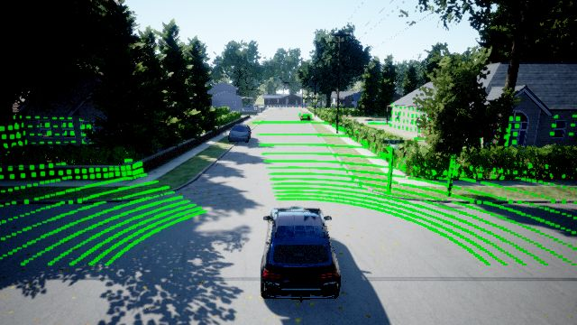
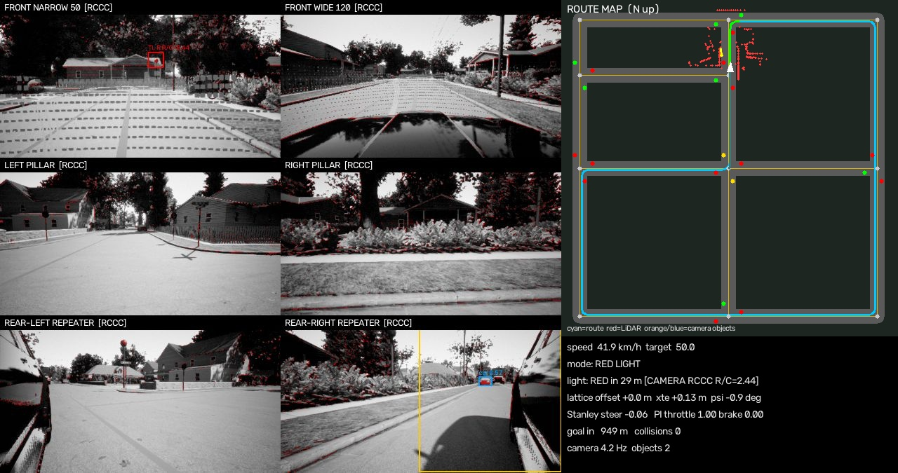
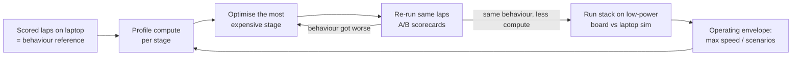

# AirSim AV Stack: self-driving behaviour on low-power compute

**End goal:** find out *how little compute* an autonomous car needs to behave correctly, and *where* the
software has to be optimised so that a low-power device (Jetson Orin Nano, Raspberry Pi 5 + NPU, other ~5–25 W
edge boards) produces the **same driving behaviour and the same safety results** as a laptop or a car-grade computer.

The project is a complete driving stack (perception → prediction → planning → control) running closed-loop in
Microsoft **AirSim** (Unreal "AirSimNH" neighbourhood map). The car has a **6-camera RCCC rig** and a
**16-channel LiDAR**, drives a 1 km city loop with traffic lights, pedestrians, street-crossers and parked-car
obstacles, and every lap is **scored automatically**. That gives a fixed behaviour reference: any optimisation
(smaller models, fewer threads, lower resolution, a different device) can be checked against it.

| Chase view (streamed to a browser) | AV dashboard: 6 RCCC cameras + BEV map + telemetry |
|---|---|
|  |  |

---

## 1. The challenge in the market

- **Compute, power and cost.** Production self-driving computers draw hundreds of watts and cost thousands
  of dollars (multi-GPU robotaxi trunks, 100–250 W driver-assist SoCs). That is fine for a robotaxi, but it rules
  out cheap vehicles, delivery robots, campus shuttles, agricultural and industrial vehicles, retrofits and
  emerging markets. Power also costs EV range, and heat costs reliability.
- **The long tail of rare events.** Lane keeping is solved; what blocks deployment are rare situations:
  double-parked vans, a pedestrian stepping out from behind a parked car, animals, washed-out traffic lights.
  Cutting compute usually means smaller models, which are **worse at exactly those rare, small, far-away
  cases**.
- **You cannot road-test your way to safety.** RAND's *Driving to Safety* (2016) estimated hundreds of millions to
  billions of miles would be needed to show statistically that an AV is safer than humans. The industry relies on
  **simulation, scenario-based testing and regression metrics**. Any compute optimisation therefore needs a
  repeatable way to prove it did not change behaviour.
- **Sensor trade-offs.** Camera-first stacks (cheap sensors, heavy neural nets) vs LiDAR + camera fusion
  (robust geometry, more expensive). Automotive **RCCC** sensors see well at night but only distinguish red vs
  not-red, which makes traffic-light reading harder with small models.
- **Safety standards demand evidence:** ISO 26262, ISO 21448 (SOTIF), UL 4600. An optimised edge build
  must come with measured, repeatable proof that it still meets the safety targets.

## 2. What we are trying to achieve

1. **A behaviour reference:** a full, readable AV stack that meets the targets on a laptop
   (0 collisions, 0 red-light violations, returns to its lane when clear, no zig-zag, up to 50 km/h).
2. **A compute budget:** measure what every stage costs (perception, LiDAR processing, tracking, planning,
   control) and how that cost turns into **reaction latency** and **detection range**.
3. **Optimise where it matters:** cut compute stage by stage (model size, input resolution, camera scheduling,
   quantisation, better algorithms) and re-run the same scored laps after every change.
4. **Prove it on the device:** run the AV stack *on the low-power board* while the simulator runs on the laptop
   (AirSim's API is network RPC, so this is hardware-in-the-loop without extra glue), and compare its scorecard
   with the laptop reference.
5. **Find the operating envelope:** for a given device, state the maximum speed / scenario complexity at
   which it still matches the reference behaviour.

## 3. At what point does low-power make sense? (current analysis)

### 3.1 Measured compute cost on this laptop (i7-7700HQ, CPU only, `bench_compute.py`)

| Stage | Config | Time per call |
|---|---|---|
| YOLOv8n | 1 camera, 416 px, 4 threads | 19 ms |
| YOLOv8n | **6 cameras**, 416 px, 4 threads | **77 ms** |
| YOLOv8n | 6 cameras, 320 px, 4 threads | 44 ms |
| YOLOv8n | 6 cameras, 416 px, **1 thread** | **199 ms** |
| YOLOv8n | 2 front cameras, 416 px, 1 thread | 67 ms |
| Lattice planner (v2) | 12 candidates × 45 m, 800 obstacle points | 11 ms |
| Lattice planner (v3b, body sweep) | 12 candidates × 45 m, 800 obstacle points | **31 ms** |

The control loop runs at 20 Hz (50 ms budget) and perception runs in its own process (all 6 cameras every 3rd cycle,
front cameras otherwise). On this laptop the simulator also shares the machine, so in-loop rates are lower.

### 3.2 Latency matters less than detection range

Stopping distance = `v·latency + v²/(2·3.5 m/s²) + 6 m margin` must fit inside the distance at which the
obstacle is reliably detected. Maximum safe speed (km/h):

| Total latency | detect at 30 m | detect at 45 m | detect at 60 m |
|---|---|---|---|
| 0.1 s | 45 | 58 | 69 |
| 0.3 s | 43 | 56 | 66 |
| 0.5 s | 41 | 54 | 64 |
| 1.0 s | 36 | 48 | 59 |

At 50 km/h each extra 100 ms of latency adds only **1.4 m** of stopping distance, but losing detection range
(for example by lowering the camera/YOLO resolution so far-away pedestrians disappear) changes the safe speed far
more. **Optimisation must protect detection range first and frame rate second.**

### 3.3 Where optimisation makes sense, in order

1. **Perception is the dominant cost.** 6 cameras × YOLO is about 75 % of the compute. Largest wins:
   - **Camera scheduling by relevance:** front cameras every cycle, side/rear cameras at low rate or only when
     turning / changing lanes (partly done: all 6 cameras only every 3rd cycle).
   - **Region-of-interest crops** instead of full frames (traffic-light area from the map, road corridor).
   - **INT8 quantisation + NPU/GPU** (ONNX → TensorRT on Jetson, Hailo on Raspberry Pi). This is usually the
     biggest single factor on edge boards.
   - **Keep resolution on the front narrow camera** (range), reduce on the wide/side cameras.
2. **Use LiDAR geometry for obstacles, cameras for semantics.** Obstacle avoidance already runs on LiDAR points,
   which is cheap; the neural network is only needed for *what* something is (person, light state).
3. **Planner algorithm, not hardware.** The v3b collision check is brute force (candidates × path samples ×
   obstacle points): 31 ms at 800 points, which is already 60 % of the 50 ms loop on a laptop and would be too slow
   on a small ARM core. Replacing it with an occupancy grid + **distance transform** (computed once per cycle,
   then O(1) lookups) should make it nearly free.
4. **Control and tracking are cheap.** Stanley + PI control and the LiDAR tracker are not worth optimising yet.

### 3.4 Where it makes sense first

Low-power stacks make sense first in **low-speed, bounded domains** (≤ 30–40 km/h): campus and airport shuttles,
last-mile delivery, parking, industrial yards, agriculture. There, detection range of 30 m and a few hundred ms of
latency are enough (table above). 50 km/h urban driving needs ≥ 45 m reliable detection, which is the harder target for a
small device. This project aims to measure exactly where that line is for a given board.

## 4. The process we follow



1. **Simulate:** `eval_loop.sh` runs N full laps with the same scenario.
2. **Measure behaviour:** every lap writes a JSON scorecard (below).
3. **Measure compute:** `bench_compute.py` today; per-stage timing inside the loop is planned.
4. **Fix or optimise behind a flag** (e.g. `--planner v2/v3`) so old and new can be compared fairly.
5. **A/B re-run:** a change is only accepted if the scorecard is at least as good. This already caught a
   regression (see §6).
6. **Hardware-in-the-loop:** run `av_stack.py` on the target board, pointing the AirSim client at the laptop's IP.

### Metrics recorded per lap

| Metric | Meaning |
|---|---|
| `collisions` | objects hit (AirSim collision info) |
| `red_violations` | stop lines crossed on red |
| `wrong_m` | metres driven with the car body over the centre line (oncoming lane) |
| `linger_m` | metres in the oncoming lane **while the own lane was already clear** |
| `excursions` | each oncoming-lane episode: length, duration, lingering metres |
| `swerves` | lattice manoeuvres into the left lane (high = zig-zagging) |
| `xte_mean / p95` | lateral tracking error vs the planned path |
| traffic-light agreement | camera RCCC classifier vs ground truth |

## 5. Architecture

```
            ┌──────────────── perception.py (own process) ────────────────┐
 6 cameras ─┤ RCCC sensor model → YOLOv8n objects → camera→ground projection│
            │ map-guided RCCC traffic-light classifier (red / not-red ratio) │
            └───────────────────────────────┬──────────────────────────────┘
 16-ch LiDAR ─ ground removal → obstacle pts │ ─ tracker (clusters, const-velocity fit) → 3 s motion prediction
                                            ▼
 av_stack.py   ROUTE: Dijkstra on street graph ── LOCAL: lattice planner (lateral-offset candidates,
               quintic transitions, collision check, cost) ── BEHAVIOUR: lights, pedestrian yield,
               obstacle stop, VRU speed cap ── SPEED: curvature + braking profiles
               CONTROL: Stanley lateral + PI longitudinal ── DASHBOARD + metrics
```

| File | Role |
|---|---|
| `airsim/av_stack.py` | planner, controller, metrics, dashboard (main program) |
| `airsim/perception.py` | 6-camera RCCC perception, YOLOv8n, traffic-light classifier, BEV grid |
| `airsim/signals.py` | physical traffic lights in the map (textures switched via API) |
| `airsim/scenario.py` | walkers, street crossers, lane obstacles |
| `airsim/drive_to.py` | v1 baseline (pure pursuit) + road graph used by the others |
| `airsim/people.py` | v1 sidewalk pedestrians |
| `airsim/calibrate_cams.py`, `cam_calib.json` | camera focal-length / height calibration |
| `airsim/eval_loop.sh`, `summarize_runs.py` | repeated scored laps + results table |
| `airsim/bench_compute.py` | compute benchmark (YOLO threads / batch / resolution, planner cost) |
| `airsim/stream_server.py` | MJPEG stream of chase view + dashboard to any browser |
| `airsim/settings_car.json` | AirSim car with 6 cameras + LiDAR |

## 6. Behaviour results so far (50 km/h target, 1035 m lap)

**Problem found:** after swerving around a parked car the vehicle **stayed in the oncoming lane**.
Root cause: the lattice cost `0.35·|offset| + 1.2·|offset − current|` made *staying* at −2.8 m (cost 0.98)
cheaper than *returning* to the lane (cost 3.36).

| Version | Laps | Oncoming lane (% of distance) | Longest excursion | Lingering after clear (m/lap) | Collisions | Swerves/lap |
|---|---|---|---|---|---|---|
| v2 (original) | 1 | **82.7 %** | 634 m | 628 | 0 | 7 |
| v3a: new cost only | 3 | **21.2 %** | 65 m | 68 | 3 (2 obstacles, 1 deer) | 26–35 |
| v3b: + body-box filter, memory, footprint sweep | – | *not yet measured* | | | | |

v3a cost: `1.5·|offset| + 0.4·|offset − current| + 2.5 (body over centre line) + 2.0 (offset ≤ −3 m)`.
It fixed the lingering but returned too early (clipped obstacles, zig-zag) because the LiDAR self-filter
removed everything within 2.6 m of the car centre and the LiDAR only sees the front 180°.
**v3b (current default)** adds a car-shaped self-filter, a 4 s memory of points beside/behind the car and a
whole-body collision sweep. It still has to be measured (issue #1), and its planner cost is part of the compute
budget above.

Earlier milestones: 0 red-light violations, camera traffic-light agreement 79–91 %, mean lateral error ≈ 0.1 m,
top speed 51.9 km/h with a LiDAR tracker + 3 s motion prediction. Raw scorecards are in [`results/`](results).

## 7. Setup

Tested on Ubuntu, NVIDIA GTX 1050 Ti (PRIME offload), AirSim **v1.8.1**.

1. Download the prebuilt **AirSimNH** Linux environment from the
   [AirSim v1.8.1 release](https://github.com/microsoft/AirSim/releases/tag/v1.8.1) and unzip it to
   `airsim/envs/AirSimNH/` (so `airsim/envs/AirSimNH/LinuxNoEditor/AirSimNH.sh` exists).
2. Python **3.9** is required (`msgpack-rpc-python` → tornado 4.x breaks on 3.10+):
   ```bash
   cd airsim
   uv venv --python 3.9 .venv
   uv pip install --python .venv setuptools numpy
   uv pip install --python .venv --no-build-isolation -r requirements.txt
   ```
   `yolov8n.pt` is downloaded automatically by ultralytics on first run.

## 8. Running

```bash
cd airsim
./run_sim.sh &                                    # start the sim (car mode), wait ~10–20 s
./run_av_demo.sh --laps 1 --speed 13.9            # lights + scenario + AV stack, 50 km/h
./eval_loop.sh v3 3 --speed 13.9 --tag v3b        # 3 scored laps, then a results table
.venv/bin/python summarize_runs.py                # table of all laps in logs/runs/
.venv/bin/python bench_compute.py                 # compute benchmark (no sim needed)
```

Compare planners: `--planner v2` (original) vs `--planner v3` (default).

**Watch remotely** (e.g. from another computer over a VPN such as Tailscale):
```bash
.venv/bin/python stream_server.py --host <vpn-ip-of-this-machine> &
./run_av_demo.sh --laps 1 --speed 13.9 --stream-file /dev/shm/av_dash.jpg
# open http://<vpn-ip>:8090/ in a browser
```
Avoid binding the stream to `0.0.0.0` on untrusted networks.

## 9. Known issues (tracked for later)

All open problems are GitHub issues with the
[`known-issue`](../../issues?q=is%3Aissue+label%3Aknown-issue) label; low-power work uses
[`low-power`](../../issues?q=is%3Aissue+label%3Alow-power).

| # | Issue | Area |
|---|---|---|
| [#1](../../issues/1) | Validate planner v3b (lane return fixes): not yet measured | planning, safety |
| [#2](../../issues/2) | Wrong-lane driving still ~18–25 m per swerve | planning |
| [#3](../../issues/3) | No oncoming-traffic check before using the opposite lane | planning, safety |
| [#4](../../issues/4) | Collisions with the map's wandering deer | perception, safety |
| [#5](../../issues/5) | Occlusion-aware pedestrian handling | planning, perception, safety |
| [#6](../../issues/6) | Camera traffic-light classifier 79–91 % agreement | perception |
| [#7](../../issues/7) | YOLOv8n runs on CPU: low perception rate | perception, low-power |
| [#8](../../issues/8) | `scenario.py` cleanup crash leaves objects in the map | tooling, simulation |
| [#9](../../issues/9) | Evaluation too small: single fixed scenario, few laps | tooling |
| [#10](../../issues/10) | AirSim quirks (cameras, FOV, SIGTERM) | simulation |
| [#11](../../issues/11) | Performance limits on GTX 1050 Ti | simulation, tooling |
| [#12](../../issues/12) | `stream_server.py` has no authentication | tooling |
| [#13](../../issues/13) | Per-stage latency logging in the control loop | low-power, tooling |
| [#14](../../issues/14) | Lattice collision check is brute force (31 ms at 800 points): use a distance transform | low-power, planning |
| [#15](../../issues/15) | Perception compute budget: camera scheduling, ROI crops, INT8 / ONNX / TensorRT | low-power, perception |
| [#16](../../issues/16) | Hardware-in-the-loop: run the AV stack on a low-power board against the laptop simulator | low-power, simulation |
| [#17](../../issues/17) | Emulate a low-power device on the laptop before buying hardware | low-power, tooling |

## 10. Roadmap

1. Measure v3b and reach the behaviour targets on the laptop (reference).
2. Per-stage latency logging in the loop + compute columns in the lap scorecard.
3. Planner collision check → occupancy grid + distance transform.
4. Perception budget: camera scheduling, ROI crops, INT8 / ONNX / TensorRT.
5. Hardware-in-the-loop on a low-power board (Jetson Orin Nano or Raspberry Pi 5 + NPU) against the laptop sim.
6. Publish the operating envelope: max speed and scenarios per device at reference behaviour.
7. Later: occlusion-aware pedestrians, oncoming-traffic gap check, randomised scenarios.
