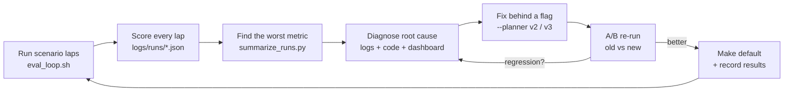

# AirSim AV Stack: a laptop-scale self-driving research loop

A full autonomous-driving software stack (perception → planning → control) running closed-loop in
Microsoft **AirSim** (Unreal Engine "AirSimNH" neighbourhood map) on a single laptop with a GTX 1050 Ti.
The car uses a **Tesla-style 6-camera rig** with an **RCCC** sensor model plus a **16-channel LiDAR**, drives a
1 km city loop with traffic lights, pedestrians, street-crossers and parked-car obstacles, and every lap is
scored automatically so that each change to the code can be measured against the previous version.

| Chase view (streamed to a browser) | AV dashboard: 6 RCCC cameras + BEV map + telemetry |
|---|---|
|  |  |

---

## 1. The challenge in the market

Self-driving is no longer a perception demo problem. It is a **validation and long-tail** problem:

- **The long tail of rare events.** Highway lane-keeping is largely solved. What stops deployment is the
  millions of rare situations: a double-parked van, a cyclist stepping out behind a parked car, a deer, a
  traffic light that is half occluded or washed out by the sun. Each one is rare, but together they decide safety.
- **You cannot road-test your way to safety.** RAND's *Driving to Safety* (2016) estimated that hundreds of
  millions to billions of miles of driving would be needed to statistically show an AV is safer than human drivers.
  Every serious programme (Waymo, Tesla, Cruise, Mobileye, Wayve, …) therefore leans heavily on **simulation,
  scenario-based testing and regression metrics** rather than raw mileage.
- **Sensor cost and architecture.** The industry is split between *camera-first* stacks (cheap sensors,
  heavy neural nets, e.g. Tesla's 8-camera "vision only" approach) and *LiDAR + camera + radar fusion*
  (more robust geometry, higher cost). Automotive cameras increasingly use **RCCC** (red-clear-clear-clear)
  sensors that are great in low light but can only tell *red vs not-red*, which makes traffic-light state
  harder to read.
- **Planning is where most "weird" behaviour shows up.** Even with perfect perception, the planner has to
  make human-like trade-offs: swerve or stop, when to return to the lane, how much margin to give.
  Bugs here are subtle. They often only appear in closed loop, after several decisions chain together.
- **Safety standards demand evidence.** ISO 26262 (functional safety), ISO 21448 / SOTIF (safety of the
  intended functionality) and UL 4600 all require measurable, repeatable evidence that the system behaves
  correctly across defined scenarios, not just a good demo video.
- **Access.** Industrial simulators and data pipelines are expensive. Students and small teams need a way to
  practise the *same engineering loop* on consumer hardware.

## 2. What we are trying to achieve

1. **A complete, understandable AV stack on one laptop:** every layer (sensors, perception, prediction,
   planning, control) written in plain Python so each decision can be read, logged and changed.
2. **An industry-like sensor setup:** 6 cameras (narrow + wide front, left/right, rear-left/rear-right),
   RCCC colour model, 16-channel LiDAR. Learn what each sensor is and isn't good at.
3. **Scenario-based testing:** a repeatable city loop with signalised junctions, walkers, street crossers
   and lane-blocking obstacles, so failures can be reproduced.
4. **Measured, not guessed:** every lap writes a JSON scorecard (collisions, red-light violations, lane
   keeping, time spent in the oncoming lane, …) so each code change is an A/B experiment.
5. **Safe-by-default behaviour targets:** 0 collisions, 0 red-light violations, return to own lane as soon as
   it is clear, no zig-zagging, at speeds up to 50 km/h.

## 3. The process we follow



1. **Simulate:** `eval_loop.sh` runs N full laps with the same scenario (traffic lights, people, obstacles).
2. **Measure:** each lap is scored automatically (see metrics below).
3. **Diagnose:** read the per-lap log, the live dashboard and the code path that made the decision.
4. **Fix behind a flag:** the old behaviour stays available (`--planner v2`), so the comparison is fair.
5. **A/B re-measure:** run old and new on the same scenario and compare tables. A fix that causes a
   regression elsewhere goes back to step 3. This happened in this project (see §5).
6. **Promote and record:** only measured improvements become the default; results are committed in `results/`.

### Metrics recorded per lap

| Metric | Meaning |
|---|---|
| `collisions` | objects hit (AirSim collision info) |
| `red_violations` | stop lines crossed on red |
| `wrong_m` | metres driven with the car body over the centre line (oncoming lane) |
| `linger_m` | metres in the oncoming lane **while the own lane was already clear** (the "won't come back" bug) |
| `excursions` | each oncoming-lane episode: length, duration, lingering metres |
| `swerves` | lattice manoeuvres into the left lane (high = zig-zagging) |
| `xte_mean / p95` | lateral tracking error vs the planned path |
| traffic-light agreement | camera RCCC classifier vs ground truth |

## 4. Architecture

```
            ┌──────────────── perception.py (own process) ────────────────┐
 6 cameras ─┤ RCCC sensor model → YOLOv8n objects → camera→ground projection│
            │ map-guided RCCC traffic-light classifier (red / not-red ratio) │
            └───────────────────────────────┬──────────────────────────────┘
 16-ch LiDAR ─ ground removal → obstacle pts │ ─ tracker (clusters, const-velocity fit) → 3 s motion prediction
                                            ▼
 av_stack.py   ROUTE: Dijkstra on street graph ── LOCAL: lattice planner (lateral-offset candidates,
               quintic transitions, collision check, cost) ── BEHAVIOUR: lights, pedestrian yield,
               obstacle stop, VRU speed cap ── SPEED: curvature + braking profiles
               CONTROL: Stanley lateral + PI longitudinal ── DASHBOARD + metrics
```

| File | Role |
|---|---|
| `airsim/av_stack.py` | planner, controller, metrics, dashboard (main program) |
| `airsim/perception.py` | 6-camera RCCC perception, YOLOv8n, traffic-light classifier, BEV grid |
| `airsim/signals.py` | physical traffic lights in the map (textures switched via API) |
| `airsim/scenario.py` | walkers, street crossers, lane obstacles |
| `airsim/drive_to.py` | v1 baseline (pure pursuit) + road graph used by the others |
| `airsim/calibrate_cams.py`, `cam_calib.json` | camera focal-length / height calibration |
| `airsim/eval_loop.sh`, `summarize_runs.py` | repeated laps + results table |
| `airsim/stream_server.py` | MJPEG stream of chase view + dashboard to any browser |
| `airsim/settings_car.json` | AirSim car with 6 cameras + LiDAR |
| `airsim/fly_path.py`, `fly_swarm.py`, `settings_drones.json` | earlier drone / 3-drone swarm experiments |
| `index.html`, `run.sh` | original three.js browser drone animation (superseded) |

## 5. Results so far (50 km/h target, 1035 m lap)

**Problem found:** after swerving around a parked car the vehicle **stayed in the oncoming lane**.
Root cause: the lattice cost `0.35·|offset| + 1.2·|offset − current|` made *staying* at −2.8 m (cost 0.98)
cheaper than *returning* to the lane (cost 3.36): the "change" penalty was larger than the "wrong lane" penalty.

| Version | Laps | Oncoming lane (% of distance) | Longest excursion | Lingering after clear (m/lap) | Collisions | Swerves/lap |
|---|---|---|---|---|---|---|
| v2 (original) | 1 | **82.7 %** | 634 m | 628 | 0 | 7 |
| v3a: new cost only | 3 | **21.2 %** | 65 m | 68 | 3 (2 obstacles, 1 deer) | 26–35 |
| v3b: + body-box filter, memory, footprint sweep | – | *not yet measured* | | | | |

**v3a cost:** `1.5·|offset| + 0.4·|offset − current| + 2.5 (body over centre line) + 2.0 (offset ≤ −3 m)`.
It fixed the lingering but returned *too early*, which caused clipped obstacles and zig-zagging. Diagnosis:

- LiDAR self-filter removed every point within **2.6 m of the car centre**, so an obstacle right beside the
  car vanished.
- LiDAR covers only the **front 180°**, so an obstacle was forgotten the moment it was beside the car.

**v3b (current default)** adds: a car-shaped self-filter box, a 4 s memory of static points beside/behind
the car, and a collision check that sweeps the whole car body (±2 m along the path). Next step is to measure it:
`./eval_loop.sh v3 3 --speed 13.9 --tag v3b`. Targets: 0 obstacle collisions, < 10 swerves/lap,
≈ 20 m of wrong-lane driving per swerve (the return manoeuvre itself).

Earlier milestones (v2 stack): 0 red-light violations, camera traffic-light agreement 81–91 %, mean lateral
error ≈ 0.1 m, top speed 51.9 km/h with a LiDAR tracker + 3 s motion prediction.

Raw lap scorecards are in [`results/`](results).

## 6. Setup

Tested on Ubuntu, NVIDIA GTX 1050 Ti (PRIME offload), AirSim **v1.8.1**.

1. Download the prebuilt **AirSimNH** Linux environment from the
   [AirSim v1.8.1 release](https://github.com/microsoft/AirSim/releases/tag/v1.8.1) and unzip it to
   `airsim/envs/AirSimNH/` (so `airsim/envs/AirSimNH/LinuxNoEditor/AirSimNH.sh` exists).
2. Python **3.9** is required (`msgpack-rpc-python` → tornado 4.x breaks on 3.10+):
   ```bash
   cd airsim
   uv venv --python 3.9 .venv
   uv pip install --python .venv setuptools numpy
   uv pip install --python .venv --no-build-isolation -r requirements.txt
   ```
   `yolov8n.pt` is downloaded automatically by ultralytics on first run.

## 7. Running

```bash
cd airsim
./run_sim.sh &                                    # start the sim (car mode), wait ~10–20 s
./run_av_demo.sh --laps 1 --speed 13.9            # lights + scenario + AV stack, 50 km/h
./eval_loop.sh v3 3 --speed 13.9 --tag v3b        # 3 scored laps, then a results table
.venv/bin/python summarize_runs.py                # table of all laps in logs/runs/
```

Compare planners: `--planner v2` (original) vs `--planner v3` (default).

**Watch remotely** (e.g. from another computer over a VPN such as Tailscale):
```bash
.venv/bin/python stream_server.py --host <vpn-ip-of-this-machine> &
./run_av_demo.sh --laps 1 --speed 13.9 --stream-file /dev/shm/av_dash.jpg
# open http://<vpn-ip>:8090/ in a browser
```
Avoid binding the stream to `0.0.0.0` on untrusted networks.

Drones: `SIM_SETTINGS=settings_drones.json ./run_sim.sh &` then `.venv/bin/python fly_swarm.py --laps 5`.

## 8. Known issues and lessons

- A custom `Cameras` block crashes some AirSim builds; `FOV_Degrees` in `CaptureSettings` is not applied, so
  FOV is set at runtime with `simSetCameraFov`.
- Spawning `DeerBothBP` through the API crashes the sim. The map's own wandering deer is still a collision source.
- `scenario.py` cleanup can fail ("IOLoop is already running"); `run_av_demo.sh` removes leftover
  `walker_/crosser_/obstacle_` objects before every lap.
- Performance on a GTX 1050 Ti: 1080p windowed + `scalability 2` ≈ 31 FPS; 4K fullscreen is unusable.

## 9. Roadmap

- Measure v3b and tune until the targets above are met
- Occlusion-aware pedestrian handling (people stepping out behind parked cars)
- YOLO on the GPU; learned traffic-light classifier
- Oncoming-traffic check before using the opposite lane
- PX4 + Gazebo for GPS-denied / visual-inertial navigation; stereo + IMU dataset recorder
